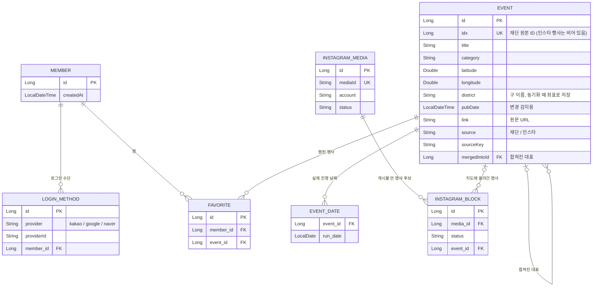

# 수원바이블 — 수원 문화행사 지도 (Spring Boot)

[](https://github.com/gwhong-dev/SuwonCultureMap/actions/workflows/ci.yml)

수원문화재단 공공 API(XML)와 수원 공식 기관 인스타그램의 행사 정보를 **DB에 동기화**하고, 카카오맵 위에 보여주는 웹 서비스입니다.

- 🌐 **운영**: https://suwonbible.com — AWS EC2 + Docker Compose, main 머지 → CI 통과 → 자동 배포
- 📦 **포트폴리오 스냅샷**: [Releases](https://github.com/gwhong-dev/SuwonCultureMap/releases) (시점 고정 태그 `portfolio-v*`)
- 🗂 **초기 정적 버전**: https://gwhong-dev.github.io/suwon-culture-map/ — 로그인 · DB 없이 보는 첫 버전 → [suwon-culture-map](https://github.com/gwhong-dev/suwon-culture-map)

---

## 기술 스택

| 구분 | 사용 기술 |
|---|---|
| Backend | Java 17, Spring Boot 4, Spring Data JPA, Flyway, Jackson XML (`XmlMapper`), RestTemplate |
| DB | MySQL 8.4 (테스트는 H2) |
| Frontend | HTML · CSS · JavaScript, Kakao Maps JavaScript API |
| 인증 | 카카오 · 구글 · 네이버 OAuth 2.0 (직접 구현), 세션 기반 |
| 인프라 | AWS EC2, Docker Compose, Caddy (HTTPS) |
| CI/CD | GitHub Actions — 빌드 · 테스트 · Docker 이미지 → 자동 배포, 15분마다 가동 감시 |
| CI 비교 | Jenkins(내 PC Docker, CI 만) 로 같은 파이프라인 재구성 · 비교 → [docs/jenkins.md](docs/jenkins.md) |

## 주요 기능

- **행사 동기화**: 재단 XML API → 파싱 → `idx` 기준으로 신규 저장 / 변경분만 갱신 (매일 06시 · 18시)
- **인스타 행사 수집**: 수원 공식 기관 계정만, 캡션을 행사별로 나눠 날짜 · 장소를 검사한 뒤 좌표를 찾은 행사만 표시 ([결정 문서](docs/decisions/2026-11-02-instagram-resume-official.md))
- **같은 행사 합치기**: 재단 · 인스타에 겹친 행사를 날짜 · 장소 · 제목으로 판단해 대표 1개만 표시, 찜은 대표 기준 유지
- **지도 · 목록**: 카테고리별 마커, 같은 장소는 마커 1개 + 개수, 검색 · 카테고리 · 지난 행사 필터
- **모바일 앱식 화면**: 하단 탭 · 상태 배지/D-day · 마커 카드 · 길찾기 창 · 상세 · 스켈레톤 로딩, 공유(카카오톡 · 링크 복사)
- **캘린더 저장**: 아이폰 캘린더(.ics) · 구글 캘린더
- **소셜 로그인 + 계정 통합**: 한 사람이 카카오 · 구글 · 네이버를 하나의 계정으로 연결 (마이페이지)
- **찜 · 회원 탈퇴**: 회원별 즐겨찾기, 탈퇴 시 찜 · 로그인 수단 · 회원 삭제 + 카카오 연결 해제. 이메일 · 이름은 저장하지 않음

## 운영 · 보안

| 항목 | 내용 | PR |
|---|---|---|
| 자동 배포 | main 머지 → CI 통과 → GitHub Actions 가 OIDC 로 AWS 임시 권한을 받아 SSM 으로 배포 (SSH 포트 · AWS 키 저장 없음) | #77, #79 |
| 가동 감시 | 15분마다 `/actuator/health` 확인, 장애 → `uptime` 라벨 Issue 자동 생성 · 복구 시 자동 닫기 | #94, #96 |
| 운영 로그 | 앱 로그를 볼륨에 날짜별 파일로 14일 · 100MB 보관 (배포해도 남음) | #107 |
| 운영 API 보호 | 수동 동기화 · 확인용 API 는 dev · test 프로필에만 등록, 운영은 스케줄러만 | #61 |
| 로그인 보안 | OAuth `state` 1회용 검증, 로그인 시 세션 ID 교체, 세션 쿠키 설정 | #17 등 |
| 보안 헤더 | nosniff · 클릭재킹 차단 · Referrer · Permissions-Policy, 운영 HSTS | #95 |
| CSP | `script-src` · `style-src` 를 우리 서버(+ 카카오 SDK · Google Fonts)로 제한, 인라인 스크립트 · 스타일 재유입은 테스트가 막음 | #104, #109, #113 |
| SRI | 카카오 공유 SDK 에 `integrity` 해시 | #114 |
| Mixed Content | 재단 이미지 주소를 https 로 저장 → 운영 http 0건 확인 | #116, #121 |

- 배포 · 로그 보기 절차: [docs/deploy-ec2.md](docs/deploy-ec2.md)

## 데이터 흐름

```
수원문화재단 API (XML/RSS)          인스타그램 공식 계정 (Business Discovery)
        │  RestTemplate                     │  캡션 → 행사 블록 → 날짜 · 장소 검사
        ▼                                   ▼
EventSyncService (idx 로 신규/갱신)    카카오 로컬 API (장소 → 좌표)
        │                                   │
        └──────────────┬────────────────────┘
                       ▼  JPA
                     MySQL ── 같은 행사 합치기 (대표 1개, 원본 행은 보존)
                       │
                       ▼
REST API (/api/events, /api/favorites, /api/auth, /api/members)
                       │  fetch
                       ▼
index.html (카카오맵 + 목록 + 상세)
```

- 프론트는 외부 API 를 직접 부르지 않음 → **API 키 노출 방지 + 외부 서버 장애와 분리**
- 행사 데이터를 DB에 저장하는 이유: 검색 · 정렬 · 찜 연결, 응답 속도

## ERD

스키마는 Flyway 로 관리합니다 (`src/main/resources/db/migration`, V1 ~ V6).



### 설계하면서 결정한 것

| 결정 | 이유 |
|---|---|
| `Event.idx` UNIQUE | 동기화를 반복해도 같은 행사가 중복 저장되지 않게. 인스타 행사는 `(source, sourceKey)` UNIQUE |
| `Member` ↔ `LoginMethod` 분리 | 한 사람이 여러 소셜 계정을 하나로 묶을 수 있게. `UNIQUE(provider, providerId)` |
| 개인정보 칸 없음 | 이메일 · 닉네임은 저장하지 않고 제공자 · 식별값 · 가입 시각만 |
| `Favorite` 별도 조인 테이블 | 한 행사를 여러 회원이 찜할 수 있게 (N:M). `UNIQUE(member_id, event_id)` |
| `mergedIntoId` 로 숨김 | 겹친 행사를 지우지 않고 대표를 가리킴 → 다시 계산할 수 있고 찜도 유지 |
| 인스타 처리 상태는 별도 테이블 | 지도에 보이는 행사는 `Event` 한 곳, 캡션 원문은 저장하지 않음 |
| `category`는 Enum 대신 String | 재단이 카테고리를 추가해도 매핑 에러가 나지 않게 |

## API

| Method | URL | 설명 |
|---|---|---|
| GET | `/api/events` | 행사 목록 |
| GET | `/api/events/{id}/calendar.ics` | 캘린더 파일(.ics) |
| GET | `/api/events/{id}/calendar/google` | 구글 캘린더 추가 링크로 이동 |
| POST | `/api/events/sync` | 재단 API 수동 동기화 (개발 전용, 운영은 매일 06시 · 18시 자동 실행) |
| DELETE | `/api/members/me` | 회원 탈퇴 (찜 · 로그인 수단 · 회원 삭제, 카카오 연결 해제) |
| GET | `/api/favorites` | 내 찜 목록 |
| POST / DELETE | `/api/favorites/{eventId}` | 찜 추가 / 해제 |
| GET | `/api/auth/{kakao·google·naver}/login` | 소셜 로그인 시작 (인증 페이지로 이동) |
| GET | `/api/auth/{kakao·google·naver}/callback` | 소셜 로그인 콜백 |
| GET | `/api/auth/me` | 로그인 상태 |
| POST | `/api/auth/logout` | 로그아웃 |
| GET | `/actuator/health` | 헬스체크 (가동 감시용) |

## 실행 방법

설정 파일을 **개발(dev) / 운영(prod)** 으로 나눠 두었습니다.

| 파일 | 내용 | Git |
|---|---|---|
| `application.properties` | 공통 설정 (비밀값 없음) | ✅ 올림 |
| `application-dev.properties` | 내 PC용 실제 키·DB 비밀번호 | ❌ 안 올림 |
| `application-prod.properties` | 운영용 — 값은 전부 환경변수에서 읽음 | ✅ 올림 |

### 개발 환경 (내 PC)

1. MySQL에 `suwon_culture_map` 데이터베이스 생성
2. `src/main/resources/application-dev.properties.example` 을 복사해 `application-dev.properties` 로 이름 변경 → 실제 값 채우기
3. `./mvnw spring-boot:run` → http://localhost:8080
4. 행사 가져오기 (개발 환경은 자동 실행 안 함): `curl.exe -X POST http://localhost:8080/api/events/sync` (Mac · Linux 는 `curl`)

> 프로필을 따로 정하지 않으면 자동으로 `dev` 로 실행됩니다.

시험: `./mvnw test` (test 프로필, H2 — MySQL 불필요) · `node --test "src/test/js/*.test.js"` (화면 표시 규칙 · 길찾기 링크)

### Docker로 실행 (MySQL 설치 없이)

[Docker Desktop](https://www.docker.com/products/docker-desktop/) 만 있으면 앱 + MySQL 을 한 번에 띄웁니다.

1. `scripts\setup-docker.cmd` 더블클릭 → `application-dev.properties` 를 읽어 `.env` 자동 생성 (Git 제외)
2. `docker compose up --build` → http://localhost:8080
3. 끄기: `Ctrl + C` 또는 `docker compose down` (DB 데이터는 볼륨에 유지, 완전 삭제는 `docker compose down -v`)

> Docker 안에서는 `prod` 프로필로 실행됩니다. 재단 행사가 없는 새 DB는 앱이 뜬 직후 자동으로 동기화하고, 이후 매일 06시 · 18시에 다시 실행합니다.
> 컨테이너 MySQL 은 내 PC MySQL(3306)과 겹치지 않게 `localhost:3307` 로 열리며, 앱 · DB 포트 모두 그 컴퓨터 안에서만 접속할 수 있습니다. `port is already allocated` 가 나면 `.env` 에 `DB_PORT=3308` 처럼 다른 번호를 넣으세요.
> 로컬에서 `mvnw spring-boot:run` 으로 앱을 켜 둔 상태면 8080 이 겹치니 먼저 끄세요.
> 루트에 예전 `.env` 가 있으면 스크립트가 건너뛰므로, 지우고 다시 실행하세요.

### 운영 환경 (서버)

`SPRING_PROFILES_ACTIVE=prod` 와 아래 환경변수를 서버에 설정한 뒤 실행합니다. 서버 준비 · 배포 절차는 [docs/deploy-ec2.md](docs/deploy-ec2.md).

`APP_BASE_URL` · `DB_URL` · `DB_USERNAME` · `DB_PASSWORD` · `SWCF_API_KEY_EVENT` · `KAKAO_REST_API_KEY` · `KAKAO_CLIENT_SECRET` · `GOOGLE_CLIENT_ID` · `GOOGLE_CLIENT_SECRET` · `NAVER_CLIENT_ID` · `NAVER_CLIENT_SECRET`

선택 항목: `KAKAO_ADMIN_KEY`(탈퇴 때 카카오 연결 해제) · `INSTAGRAM_SYNC_ENABLED`(인스타 수집 · 표시 스위치, 기본 false, 공식 계정만 [재개 결정](docs/decisions/2026-11-02-instagram-resume-official.md)) · `INSTAGRAM_ACCESS_TOKEN` · `INSTAGRAM_USER_ID` · `INSTAGRAM_TOKEN_EXPIRES_AT` · `INSTAGRAM_ACCOUNTS`(인스타 수집) · `APP_SYNC_CRON`(자동 동기화 시각, 기본 매일 06시 · 18시) · `SESSION_COOKIE_SECURE`(기본 true, HTTPS 없이 시험할 때만 false)

> 운영에는 Docker 이미지를 쓰세요. 내 PC 에서 `mvnw package` 로 만든 jar 에는 `application-dev.properties` 가 들어갈 수 있습니다.
> 소셜 로그인 콜백 주소는 `APP_BASE_URL` 기준으로 자동 생성됩니다. 각 개발자 콘솔(카카오·구글·네이버)에 운영 주소의 콜백 URL도 등록해야 합니다.

## 트러블슈팅

| 문제 | 원인 | 해결 | PR |
|---|---|---|---|
| 상세창 '원문 보기' 버튼이 사라짐 | ① XML `description` 안의 HTML 때문에 뒤의 `link` 파싱이 꼬임 ② 동기화가 기존 행사를 무조건 건너뛰어 `link`가 계속 비어 있음 | ① `description` 매핑 제거 ② `pubDate`가 최신이거나 `link`가 비어 있으면 기존 행사도 갱신 | #5, #6 |
| XML 한 행의 형식 오류로 뒤 행사가 저장되지 않음 | 한 행의 파싱 실패가 전체 반복을 멈춤 | 그 행만 건너뛰고 `skipped` 개수 · idx 기록 | #78 |
| 자동 배포가 `AssumeRoleWithWebIdentity` 거부로 실패 | GitHub 이 보내는 `sub` 형식과 AWS 신뢰 정책이 다름 (진단 단계를 넣어 실제 값 확인) | 신뢰 정책을 실제 형식에 맞춤 → 머지 후 1분 40초 배포 | #77, #79 |
| 카카오톡 공유가 늘 실패 안내로 끝남 | SDK v2 는 `Kakao.init()` 뒤에야 `Kakao.Share` 가 생기는데 init 전에 검사 | init 먼저, 옛 코드면 실패하는 테스트 추가 | #106 |
| https 화면에 재단 이미지가 http 로 옴 (Mixed Content) | 재단 XML 이미지 주소가 `http://` | 저장할 때 https 로 바꾸고 옛 행도 다음 동기화에 갱신 → 운영 http 0건 | #116, #121 |
| 폰에서 지도가 빈 화면 | 카카오 JavaScript SDK 도메인에 `localhost`만 등록 | 접속 주소(IP·배포 도메인)를 SDK 도메인에 추가 | — |
| 같은 장소 행사가 1개로 보임 | 같은 좌표 마커가 겹침 | 장소별로 묶어서 개수 뱃지 + 목록 | — |

## 개발 방식

- 국비 IT 풀스택 과정 중 1인 개인 프로젝트 · AI(Claude Code)와 함께 작성
- **한 PR = 한 가지 목적**: 기능 브랜치 → PR → CI(빌드 · 테스트 · Docker 이미지) 통과 → 머지. main 은 브랜치 보호로 CI 통과가 필수
- 작업 크기(S/M/L)에 따라 **작업 과정을 모르는 검증 에이전트**가 코드만 보고 파일 · 줄 근거로 검토 → PR 댓글 1개로 판정 → 지적 반영 뒤 머지. L 등급은 PC 에서 앱 · 화면 · DB 까지 직접 확인
- 머지 뒤 자동 배포 · 운영 헬스체크까지 확인하고, 진행 현황은 [PROGRESS.md](PROGRESS.md) 에 기록
- 11/5 기준 PR 149개 중 146개 머지, 테스트 `mvnw test` 533개 · `node --test` 93개
