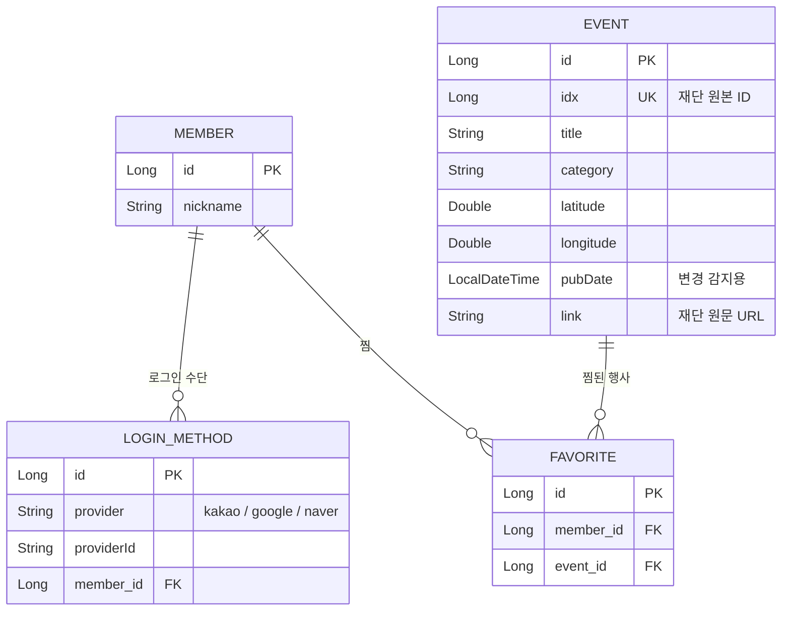

# 수원 문화지도 — Spring Boot 원본 버전

수원문화재단 공공 API(XML)의 행사 정보를 **DB에 동기화**하고, 카카오맵 위에 보여주는 웹 서비스의 **백엔드 포함 원본**입니다.

- 🌐 **배포 버전(바로 써보기)**: https://gwhong-dev.github.io/suwon-culture-map/
  - 로그인·DB 없이 누구나 볼 수 있게 만든 정적 버전 → [suwon-culture-map](https://github.com/gwhong-dev/suwon-culture-map)
- 🧩 **이 저장소**: 백엔드(동기화 · 소셜 로그인 · 계정 통합 · 찜)가 있는 전체 버전

---

## 기술 스택

| 구분 | 사용 기술 |
|---|---|
| Backend | Java 17, Spring Boot 4, Spring Data JPA, Jackson XML (`XmlMapper`), RestTemplate |
| DB | MySQL |
| Frontend | HTML · CSS · JavaScript, Kakao Maps JavaScript API |
| 인증 | 카카오 · 구글 · 네이버 OAuth 2.0 (직접 구현) |

## 주요 기능

- **행사 동기화**: 재단 XML API → 파싱 → `idx` 기준으로 신규 저장 / 변경분만 갱신
- **지도**: 카테고리별 마커, 같은 좌표 행사는 마커 1개 + 개수 뱃지 + 목록 팝업
- **검색 · 필터**: 행사 이름, 카테고리, 지난 행사 보기
- **소셜 로그인 + 계정 통합**: 한 사람이 카카오·구글·네이버를 하나의 계정으로 연결 (마이페이지)
- **찜**: 회원별 즐겨찾기 (`Favorite` 조인 테이블)
- **반응형**: PC는 사이드바, 모바일·태블릿(1024px 이하)은 앱 스타일 바텀시트

## 데이터 흐름

```
수원문화재단 API (XML/RSS)
        │  RestTemplate
        ▼
EventSyncService ── XmlMapper로 파싱 → idx로 신규/갱신 판단
        │  JPA
        ▼
      MySQL
        │
        ▼
REST API (/api/events, /api/favorites, /api/auth)
        │  fetch
        ▼
index.html (카카오맵 + 목록)
```

- 프론트는 재단 API를 직접 부르지 않음 → **API 키 노출 방지 + 재단 서버 장애와 분리**
- 행사 데이터를 DB에 저장하는 이유: 검색·정렬·찜 연결, 응답 속도

## ERD



### 설계하면서 결정한 것

| 결정 | 이유 |
|---|---|
| `Event.idx` UNIQUE | 동기화를 반복해도 같은 행사가 중복 저장되지 않게 |
| `Member` ↔ `LoginMethod` 분리 | 한 사람이 여러 소셜 계정을 하나로 묶을 수 있게. `UNIQUE(provider, providerId)` |
| `Favorite` 별도 조인 테이블 | 한 행사를 여러 회원이 찜할 수 있게 (N:M). `UNIQUE(member_id, event_id)` |
| `category`는 Enum 대신 String | 재단이 카테고리를 추가해도 매핑 에러가 나지 않게 |
| 사진·상세정보는 문자열로 평탄화 | 정해진 개발 시간 안에서 정규화 대신 단순화 |

## API

| Method | URL | 설명 |
|---|---|---|
| GET | `/api/events` | 행사 목록 |
| POST | `/api/events/sync` | 재단 API 동기화 (신규 저장 + 변경 갱신) |
| GET | `/api/favorites` | 내 찜 목록 |
| POST / DELETE | `/api/favorites/{eventId}` | 찜 추가 / 해제 |
| GET | `/api/auth/{kakao·google·naver}/login` | 소셜 로그인 시작 (인증 페이지로 이동) |
| GET | `/api/auth/{kakao·google·naver}/callback` | 소셜 로그인 콜백 |
| GET | `/api/auth/me` | 로그인 상태 |
| POST | `/api/auth/logout` | 로그아웃 |

## 실행 방법

설정 파일을 **개발(dev) / 운영(prod)** 으로 나눠 두었습니다.

| 파일 | 내용 | Git |
|---|---|---|
| `application.properties` | 공통 설정 (비밀값 없음) | ✅ 올림 |
| `application-dev.properties` | 내 PC용 실제 키·DB 비밀번호 | ❌ 안 올림 |
| `application-prod.properties` | 운영용 — 값은 전부 환경변수에서 읽음 | ✅ 올림 |

### 개발 환경 (내 PC)

1. MySQL에 `suwon_culture_map` 데이터베이스 생성
2. `src/main/resources/application-dev.properties.example` 을 복사해 `application-dev.properties` 로 이름 변경 → 실제 값 채우기
3. `./mvnw spring-boot:run` → http://localhost:8080 → **행사 동기화** 버튼

> 프로필을 따로 정하지 않으면 자동으로 `dev` 로 실행됩니다.

### Docker로 실행 (MySQL 설치 없이)

[Docker Desktop](https://www.docker.com/products/docker-desktop/) 만 있으면 앱 + MySQL 을 한 번에 띄웁니다.

1. `scripts\setup-docker.cmd` 더블클릭 → `application-dev.properties` 를 읽어 `.env` 자동 생성 (Git 제외)
2. `docker compose up --build` → http://localhost:8080 → **행사 동기화** 버튼
3. 끄기: `Ctrl + C` 또는 `docker compose down` (DB 데이터는 볼륨에 유지, 완전 삭제는 `docker compose down -v`)

> Docker 안에서는 `prod` 프로필로 실행됩니다. DB는 새로 만들어지므로 처음 한 번은 동기화가 필요합니다.
> 컨테이너 MySQL 은 내 PC MySQL(3306)과 겹치지 않게 `localhost:3307` 로 열립니다.

### 운영 환경 (서버)

`SPRING_PROFILES_ACTIVE=prod` 와 아래 환경변수를 서버에 설정한 뒤 실행합니다.

`APP_BASE_URL` · `DB_URL` · `DB_USERNAME` · `DB_PASSWORD` · `SWCF_API_KEY_EVENT` · `KAKAO_REST_API_KEY` · `KAKAO_CLIENT_SECRET` · `GOOGLE_CLIENT_ID` · `GOOGLE_CLIENT_SECRET` · `NAVER_CLIENT_ID` · `NAVER_CLIENT_SECRET`

> 소셜 로그인 콜백 주소는 `APP_BASE_URL` 기준으로 자동 생성됩니다. 각 개발자 콘솔(카카오·구글·네이버)에 운영 주소의 콜백 URL도 등록해야 합니다.

## 트러블슈팅

| 문제 | 원인 | 해결 |
|---|---|---|
| 상세창 '원문 보기' 버튼이 사라짐 | ① XML `description` 안의 HTML 때문에 뒤의 `link` 파싱이 꼬임 ② 동기화가 기존 행사를 무조건 건너뛰어 `link`가 계속 비어 있음 | ① `description` 매핑 제거 ② `pubDate`가 최신이거나 `link`가 비어 있으면 기존 행사도 갱신 |
| 폰에서 PC 화면이 축소돼 보임 | `viewport` 메타 태그 없음 | viewport 추가 + 1024px 이하 앱 스타일 레이아웃 |
| 폰에서 지도가 빈 화면 | 카카오 JavaScript SDK 도메인에 `localhost`만 등록 | 접속 주소(IP·배포 도메인)를 SDK 도메인에 추가 |
| 같은 장소 행사가 1개로 보임 | 같은 좌표 마커가 겹침 | 장소별로 묶어서 개수 뱃지 + 목록 |

## 개발 과정

- 국비 IT 풀스택 과정 중 개인 프로젝트 · AI(Claude)와 함께 작성하고 **직접 실행·확인 후 반영**
- 작업 단위별 PR: [#3 PC 화면](../../pull/3) · [#4 모바일·태블릿](../../pull/4) · [#5 동기화 수정](../../pull/5)
