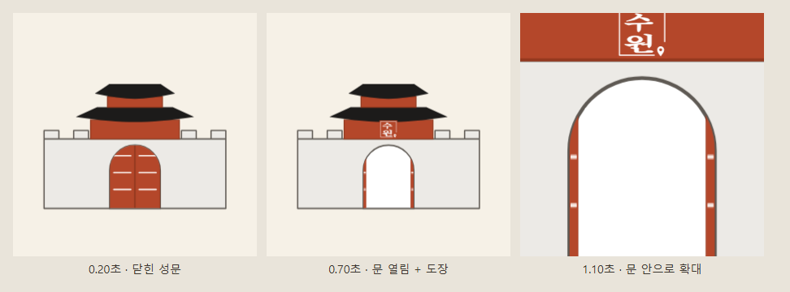
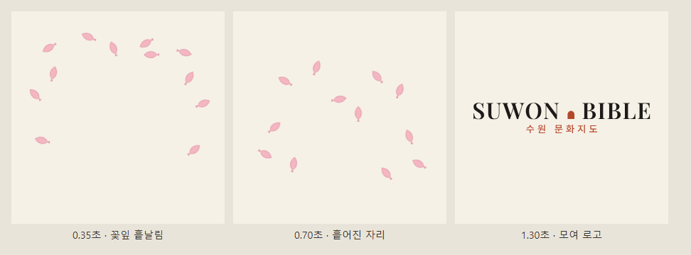
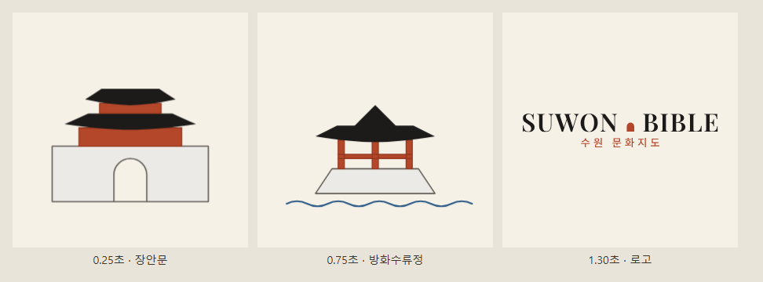

# 첫 진입 애니메이션 B안 확정 (2026-11-13)

> 시안: [docs/design/2026-11-13-improvement-drafts.md](../design/2026-11-13-improvement-drafts.md) "P7". 3안 개발 = PR [#242](https://github.com/gwhong-dev/SuwonCultureMap/pull/242) (주소 `?intro=a|b|c` 일 때만 재생하던 고르기 단계).

## 결정

- **B안(계절 꽃잎 → 로고)으로 확정** — 사용자가 11/13 운영(suwonbible.com)에서 `?intro=a` · `?intro=b` · `?intro=c` 를 직접 보고 고름
- 재생 조건: **이 기기에서 처음 들어왔을 때 1회** (localStorage `introSeen`). 재생을 시작하면 건너뛰어도 본 것으로 기록
  - 저장소가 막혀 있으면(사생활 보호 모드 · 쿠키 차단 · 저장 공간 꽉 참) 기록을 못 해 매번 나올 수 있으므로 **재생 안 함**
  - 미리 보기 `?intro=b` 는 기록과 상관없이 매번 재생 (포트폴리오 시연용), `&season=spring|autumn` 로 계절 고정. `?intro=a` · `?intro=c` 는 이제 그냥 주소와 같음 (미리 보기 아님 — 이 기기 처음 방문이면 B안이 1회 나옴)
  - 그대로 둔 것: 누르거나 키 누르면 건너뜀(누른 키는 아래 화면까지 안 감), `prefers-reduced-motion` 이면 생략, CSP 때문에 style 속성 없이 클래스 + SVG 속성으로만 그림
- 화면 시안 단계(CLAUDE.md 4-2)는 생략 — 운영에서 실제 움직임을 보고 고른 것이라서

## 용어

| 용어(영문) | 뜻 한 줄 | 이 프로젝트에서 |
|---|---|---|
| 인트로 애니메이션 (intro animation) · 스플래시 화면 (splash screen) | 본 화면 전에 잠깐 덮는 화면 | `intro.js` 가 붙이는 덮개 `.intro`, 1.5초 |
| 시안 · 변형 (variant) | 같은 목적의 여러 안 | a · b · c (#242 의 `INTRO_VARIANTS`, 지금은 B 만 남음) |
| 키프레임 애니메이션 (keyframe animation) | 시작 · 중간 · 끝 모습만 정하면 사이를 브라우저가 채움 | B `@keyframes ib-petal` · `intro-logo` / A `ia-door-l` · `ia-door-r` · `ia-seal` · `ia-zoom` / C `ic-gate` · `ic-pavilion` · `intro-logo-c` |
| 트랜지션 (transition) | 값 하나가 바뀔 때 부드럽게 넘어감 | 끝날 때 `transition: opacity 0.3s` 페이드 아웃 (`.intro-out`) |
| 이징 (easing) | 움직임 빠르기 곡선 | `ease-out`(로고) · `ease-in-out`(꽃잎) · `ease-in`(A 확대) |
| 파티클 (particle) 효과 · 모임 (converge) · 페이드 인 (fade-in) | 작은 조각 여러 개를 흩뿌렸다 한곳으로 모으고, 나타나게 함 | B안 꽃잎 12장 → 가운데로 모임 → 로고 나타남 |
| 문 열림 (reveal) · 스탬프 (scale-in) · 줌 인 (zoom-in) 전환 | 가린 것을 열어 보이기 · 크게 나타나 찍히기 · 확대해 들어가기 | A안 문 두 짝 `scaleX` · 도장 `scale` + `rotate` · 문 안 `scale(7)` |
| 크로스페이드 (crossfade) 장면 전환 | 앞 장면이 사라지며 다음 장면이 겹쳐 나타남 | C안 장안문 → 방화수류정 → 로고 |
| 쿼리 파라미터 (query parameter) | 주소 `?` 뒤 값으로 동작 고르기 | `?intro=b` · `&season=autumn` |
| 모션 디자인 (motion design) | 화면 움직임을 다루는 분야 | 이 결정 전체 |
| localStorage (이번에 새로 씀) | 브라우저에 기기별로 남기는 값 | `introSeen` = "처음 방문 1회" 기록 |

## 3안 비교

시간은 모두 1.5초 움직임 + 0.3초 사라짐. 장면은 `b0ce186`(3안 + 새 로고 W4) 코드로 그린 정지 화면 (아래 "되살리는 법" 의 파일로 다시 찍음).

| 안 | 흐름 | 쓴 CSS 효과 | 좋은 점 | 아쉬운 점 |
|---|---|---|---|---|
| A 성문 | 닫힌 성문 → 0.7초 문 두 짝이 열리고 문루에 도장이 찍힘 → 1.5초 문 안으로 확대되며 지도로 | 문 짝 `scaleX` (`transform-box: fill-box` · 경첩 쪽 `transform-origin`), 도장 `scale` + `rotate` 로 찍히는 느낌, 전체 `scale(7)` 확대 + `clipPath` 로 문 안만 보이게 | "성 안으로 들어간다"는 이야기가 가장 분명함 | 그림이 많아 1.5초 안에 볼 것이 많음. 마지막에 로고가 없음. 확대 끝 장면이 문 안 빈칸이라 어두운 테마 색을 따로 맞춰야 했음 |
| **B 꽃잎 (확정)** | 꽃잎 12장이 위 · 양옆에서 흩날림 → 0.7초 흩어진 자리 → 가운데로 모여 작아지며 사라지고 로고 W4 가 나타남 | 꽃잎마다 CSS 변수(`--x0 · --y0 · --r0 → --x1 · --y1 · --r1`)로 출발 · 중간 자리만 다르게 하고 키프레임 하나를 같이 씀, 로고 `opacity` + `scale(0.92→1)` | 가볍고 짧아 매번 봐도 덜 지루함. 계절(3~8월 벚꽃 · 9~2월 은행잎)로 다시 와도 달라짐. 끝이 로고라 서비스 이름이 남음 | 수원 · 화성이라는 장소 느낌은 A · C 보다 약함 |
| C 명소 | 장안문(0~0.5초) → 방화수류정(0.5~1초) → 로고(1~1.5초) | 장면 3개를 같은 칸에 겹치고 `opacity` 를 시간대별로 넘김(교차 전환), 각 장면 `scale(0.96→1.04)` 로 살짝 다가옴 | 수원화성 명소를 바로 보여 줌 | 장면당 0.5초라 그림을 알아보기 전에 넘어감. 장면 넘김이 슬라이드쇼처럼 보임 |

| A 성문 | B 꽃잎 (확정) | C 명소 |
|---|---|---|
|  |  |  |

## 버린 안 A · C 되살리는 법

이 PR 에서 `static/intro.js` · `static/css/intro.css` 의 A · C 그림 · 키프레임을 지웠다. 3안이 모두 들어 있는 코드는 git 에 남아 있다.

| 커밋 | 내용 |
|---|---|
| `04ae119` (#242 머지) | 3안을 처음 만든 상태. 로고 끝 장면은 옛 로고(도장 + 글자) |
| `b0ce186` (이 PR 직전 main) | 3안 + 새 로고 B안(W4 워드마크, #251) 반영 상태 — 되살릴 땐 이쪽이 지금 화면과 맞음 |

```bash
git show b0ce186:src/main/resources/static/intro.js > intro-abc.js
git show b0ce186:src/main/resources/static/css/intro.css > intro-abc.css
git show 04ae119:src/main/resources/static/intro.js   # #242 원래 모습
```

- 되살린 파일은 주소 `?intro=a|b|c` 로 안을 고르는 구조 (`introVariant` · `introHtml(variant, season)`). 지금 B안 파일의 "처음 1회" 기록(`readIntroSeen` · `markIntroSeen`)과 합치려면 `introHtml` 만 안별로 나누면 됨
- 시험도 같은 커밋의 `src/test/js/intro.test.js` 에 A · C 확인(문 두 짝 · 도장 · 장면 순서 · 어두운 테마 문 안 색)이 있음
